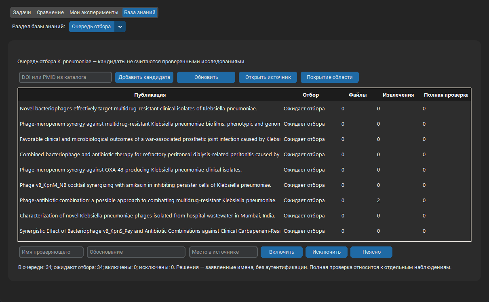

# PhageATB

PhageATB is a Windows desktop application for researchers studying bacteriophage–antibiotic combinations. A researcher can import laboratory measurements from CSV or Excel, compare them with published observations, and export a report for a colleague to review. Each literature observation records the assay method, experimental conditions, source and review status.

## Published checkerboard example

**[Read the one-page example report (PDF)](PhageATB_Checkerboard_Example.pdf)**

In Figure 6a, Shein and colleagues reported a fractional inhibitory concentration index (FICI) of **0.225** for the highlighted combination. PhageATB 11.16.1 reproduced **0.225** from the published matrix. The report shows how the figure was read and which arithmetic checks were performed. The colour bands in the figure do not preserve individual replicate measurements. [Original publication, Figure 6a](https://doi.org/10.1038/s41598-024-79924-9)

## Inside the application

The literature screening queue in the Russian interface. The pilot contains 34 publication records. Each row shows the screening decision, the number of files and extracted observations, and how many observations have completed review.

## Development

Nikita Kuxa developed PhageATB with guidance from his academic supervisors. Version 11.16.1 is intended for research use. Clinical validation has not been performed.
